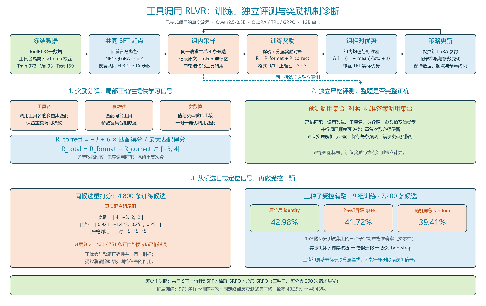
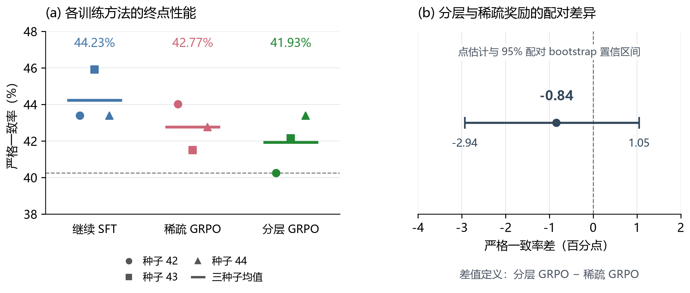
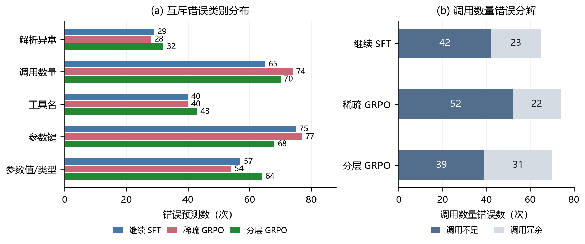
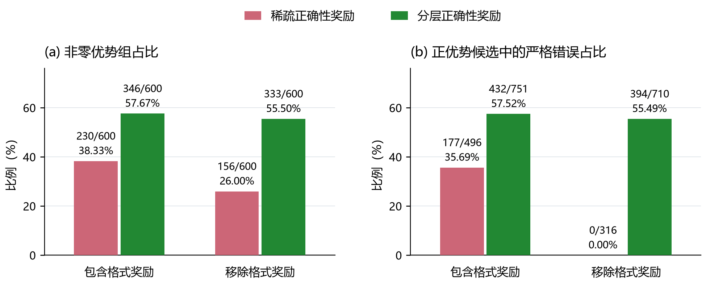
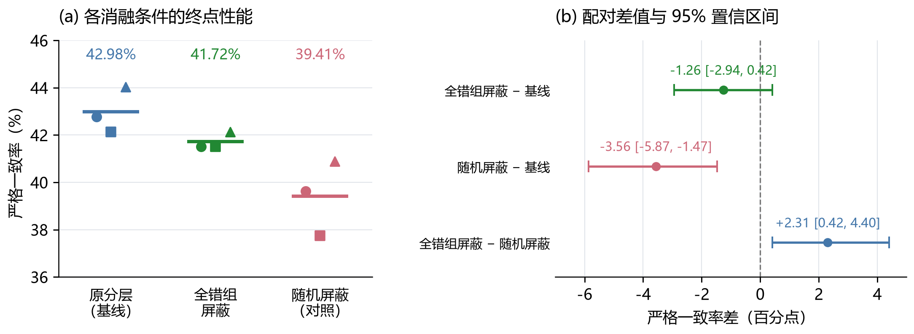
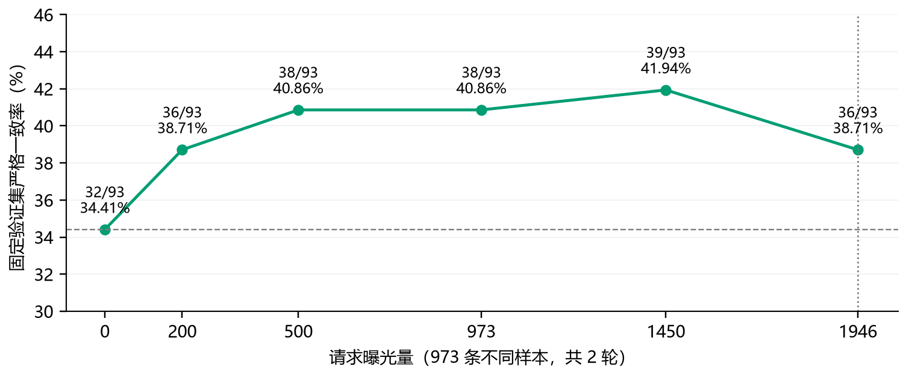

# Tool-call RLVR：小模型后训练与奖励诊断

**Qwen2.5-0.5B-Instruct · SFT / QLoRA / GRPO · 独立严格评测 · 三种子对照 · 受控消融**

在单张 4GB 显存设备上构建工具调用后训练流程，研究：**分层奖励提供更多局部反馈，是否能提高完整工具调用的正确率？** 项目参考 ToolRL 的奖励分解思想，独立实现类型敏感、调用顺序无关的严格评测，并结合训练候选审计与优势屏蔽检验机制假设。

任务定义为**单轮结构化工具调用**：模型根据工具定义和用户请求生成调用，以参考调用集合的严格匹配作为主要指标。

## 核心工作与结论

| 工作 | 实现 | 已获得的证据 |
|---|---|---|
| 一：数据与训练实现 | 冻结分区、工具名隔离、SFT、NF4 QLoRA、独立判据 | 统一输入、起点、请求曝光预算和评测口径；记录实际优势与参数更新 |
| 二：主对照与奖励诊断 | 继续 SFT、稀疏 GRPO、分层 GRPO；三种子 | 分层减稀疏为 **−0.84 个百分点，95% 配对 bootstrap 区间 [−2.94, 1.05]**，不支持分层更优 |
| 三：受控消融 | 原分层、全错组屏蔽、随机屏蔽对照 | 全错组屏蔽为 41.72%，原分层基线为 42.98%，未观察到改进 |
| 扩展：增加训练覆盖 | 完整 973 条训练样本、两轮、单种子 | 固定终点历史测试集严格一致率从 **40.25% 提高至 48.43%**（单种子扩展） |



*数据、策略更新、独立评测与奖励机制诊断的总体流程；扩展训练结果见最后一节。*

## 工作一：数据、奖励与训练流程

### 数据来源与冻结分区

数据来自 [ToolRL](https://github.com/qiancheng0/ToolRL) 的 `dataset/rlla_4k`，上游包含 3920 条训练记录和 80 条测试记录。对工具调用合法性、参数 schema 和长度进行筛选，冻结样本 ID、来源文件哈希及 tokenizer 配置哈希；按可用工具名称约束分区隔离。完整规则及 ID 在 [冻结清单](docs/prospective_manifest_v3.json) 中。

| 分区 | 总数 | 单调用 | 多调用 | 用途 |
|---|---:|---:|---:|---|
| 训练池 | 973 | 538 | 435 | SFT、主对照、机制干预与扩展训练 |
| 验证集 | 93 | 41 | 52 | 训练过程诊断 |
| 历史测试集 | 159 | 76 | 83 | 主对照终点评测；后续沿用时按探索性结果解释 |
| 上游测试集筛选子集 | 32 | 13 | 19 | 额外保留分区，不混入主指标分母 |

训练池并非每次全部使用：共同 SFT 使用固定 160 条监督样本；主对照每个分支、每个种子使用 200 次请求曝光。扩展训练才覆盖完整 973 条样本并训练两轮。提示长度不超过 768 tokens，完整训练序列上限 960，生成上限 160 tokens。数据准备会核验冻结哈希，发现版本变化即停止。

### 输入与监督目标

`system` 给出助手角色、可用工具的名称及参数定义、输出协议；`user` 给出用户请求和已有对话；参考 `assistant` 只用于监督或评分，生成时不会提供。

以下以训练池 ID 2 为例，system 为内容概述，工具调用保留关键原文：

```text
system（概述）
提供财经新闻、货币兑换、ESG 等可用工具。
esg 接口要求字符串参数 symb；输出使用 <think>、<tool_call> 等标签。

user
<user> Could you find the ESG score for Microsoft? </user>

参考调用
<tool_call>
{"name":"esg","parameters":{"symb":"MSFT"}}
</tool_call>
```

tokenizer 的聊天模板加入角色边界。SFT 对提示部分的标签置为 −100，只监督回答部分。并行调用用同一个 `<tool_call>` 区块中的多行 JSON 表示；参考思考前缀和外围文本不属于严格调用匹配的内容。

### 分层奖励与独立判据

训练奖励为 $R=R_{\mathrm{format}}+R_{\mathrm{correct}}$。格式项取 0 或 1。稀疏正确性奖励按完整匹配取 −3 或 3；分层正确性奖励根据工具名、参数键、参数值的匹配分数映射到 [−3,3]：

$$R_{\mathrm{correct}}=-3+6\frac{S_{\mathrm{match}}}{S_{\max}}.$$

总奖励范围为 [−3,4]，解析失败按实现的失败分支处理。奖励实现保留重复调用次数，采用同名工具的一对一最优匹配，参数值按类型敏感方式比较。上游实现中曾发现重复调用区块仍可获得部分高分的情况，本地使用唯一区块校验修正，具体规则在 `rewards_train.py`。

独立严格评测要求调用数量、工具名、参数键、参数值及类型全部一致；允许并行调用顺序交换，但必须保留重复次数。字符串、数字与布尔值不能随意互换；参数值中的列表保持顺序。评测由 `eval_strict.py` 独立实现，不将训练奖励分数直接当作正确率。

### 小显存后训练与审计

基座为 Qwen2.5-0.5B-Instruct。采用 NF4 量化、BF16 计算和 QLoRA，仅训练 q/v 投影的 LoRA 参数，秩 4、缩放系数 8，共 270,336 个可训练参数；使用梯度检查点。共同 SFT 学习率为 $10^{-4}$；后续分支学习率为 $10^{-5}$。

| 设置 | 继续 SFT | 稀疏／分层 GRPO |
|---|---|---|
| 起点 | 同一 SFT adapter | 同一 SFT adapter，核验 FP32 参数恢复 |
| 种子 | 42、43、44 | 42、43、44 |
| 每支请求曝光 | 200 | 200 |
| 优化步数 | 100 | 200 |
| 每请求候选 | 监督参考回答 | 4 条随机采样回答 |

请求曝光相同并不意味着生成 token 数或计算成本相同。GRPO 使用 temperature=0.8、top-p=0.95，KL 系数为 0、每批一次更新；组相对优势为

$$A_i=\frac{R_i-\overline R}{s_R+10^{-4}},$$

其中 $s_R$ 使用组内样本标准差。训练保存候选原文、token、奖励、独立判定和实际 TRL 优势，同时检查梯度与 LoRA 参数变化。正优势表示奖励高于组均值，不表示整题正确；日志中的标量损失接近零也不能独立证明没有梯度更新。

## 工作二：三分支对照与奖励诊断

### 终点性能：直接回答研究问题

159 道相同测试题、3 个训练种子，每分支 477 次预测。

| 分支 | 正确预测数 | 三种子平均严格一致率 |
|---|---:|---:|
| 继续 SFT | 211/477 | 44.23% |
| 稀疏 GRPO | 204/477 | 42.77% |
| 分层 GRPO | 200/477 | 41.93% |



**分层奖励没有在本次主对照中体现出严格一致率优势。** 按测试 ID 配对，在单／多调用层内 bootstrap 重采样 10,000 次，分层减稀疏为 −0.84 个百分点，95% 区间 [−2.94,1.05]。区间跨零，不支持分层更优，也不证明二者等效。区间以已训练的三个种子结果为条件，反映测试样本不确定性，未完整涵盖重新训练的随机性。模型容量较小、训练覆盖有限是合理假设，当前实验不能确认其因果作用。

### 错误结构：哪里丢分

按“解析→调用数量→工具名→参数键→参数值／类型”的首次失败条件互斥归类。图中进一步区分长度上限未闭合与其他解析异常。



1. **共同错误集中于调用数量、参数键和参数值／类型**，合计占各分支错误的 72.9%–75.1%。数量错误中少调用较多，但这不等于消除了题目结构的影响：单调用题与多调用题数量、难度和可犯错误机会不同。
2. **分层比稀疏有更少的参数键错误，但更多的值／类型错误**：分别为 68 对 77 次、64 对 54 次。这是通过前层检查后的条件计数；进入后层的样本不同，不能直接解释为参数赋值能力退化。
3. **分层比稀疏少调用更少、冗余更多**：少调用 39 对 52 次，冗余 31 对 22 次。数量错误合计减少 4 次，未转化为整体正确率优势。

在可解析的多调用题预测中，分层与稀疏的少调用比例为 39/229=17.03%、52/231=22.51%；多调用题的严格一致率均约 33.33%，低于单调用题的约 51%–53%。不同题目内容未被控制，不能据此断言调用越多必然越难。工具名不匹配时不再归入参数错误，因为工具名决定后续参数定义。以上差异均为描述性结果，不能据此证明奖励投机。

### 同候选离线重评分

固定分层分支训练过程中生成的 **600 组、2400 条候选**（3 个种子×200 次请求×4 条回答），用四套评分设置重算奖励和优势，排除候选文本变化。候选来自整个 GRPO 训练过程，统计单位为候选组及组内回答。



**分层奖励提供更多组内区分信号。** 含格式奖励时，分层与稀疏分别产生 346、230 个非零优势组；移除格式奖励后分别为 333、156 组，差距从 116 组扩大至 177 组。

**更多信号同时伴随更高比例的“未完整答对但优势为正”的回答。** 含格式奖励时，分层有 751 条正优势候选，其中 432 条严格错误（57.52%）；稀疏为 177/496（35.69%）。去掉格式项后，分层仍为 394/710，稀疏为 0/316。分层对部分正确回答给出中间分，因此错误回答也可能高于组平均奖励。这说明分层反馈增加了组内区分，同时使更多未完整答对的候选获得正优势；其训练作用由下一节的受控消融检验。

600 组中，289 组的四条候选全部严格错误，其中 189 组在原分层规则下仍有非零优势。下一步检验：**屏蔽这些全错组的组内相对信号，能否改善完整调用正确率？**

## 工作三：全错组屏蔽的受控消融

保留相同起点、数据顺序及预算，开展三个种子、三种设置，共 9 组训练、7200 条候选审计：

- **原分层基线（identity）**：不改变优势。
- **全错组屏蔽（gate）**：只有四条候选均未完整答对时，才将整组优势置零；含正确候选的组保留。
- **随机屏蔽（random，对照）**：以预先固定的概率随机屏蔽组，用来观察减少更新信号本身的影响；概率来自 189/346，不保证每次运行与 gate 屏蔽完全相同数量。



| 设置 | 三种子平均严格一致率 |
|---|---:|
| 原分层基线 | 42.98% |
| 全错组屏蔽 | 41.72% |
| 随机屏蔽对照 | 39.41% |

**屏蔽全错组未改善本次结果。** 相对原分层基线，平均差为 −1.26 个百分点，配对区间 [−2.94,0.42] 跨零。结果不支持一概删除全错组信号；部分正确性反馈的具体作用仍需进一步区分。

该实验使用独立运行的 identity 基线，核验实际优势与梯度，并逐题统计正确与错误的迁移。机制干预沿用主对照测试集，属于探索性分析。

## 扩展训练：覆盖完整训练池

沿用共同 SFT 起点和原分层奖励，使用完整 **973 条不同训练样本训练两轮**，即 1946 次请求曝光、7784 条候选；预先固定第 1946 次曝光为终点，采用单个种子。没有新增等预算的稀疏奖励或继续 SFT 对照。



*训练过程仅用固定的 93 题验证集诊断，正确数依次为 32、36、38、38、39、36，对应曝光次数 0、200、500、973、1450、1946。未用中途最佳成绩替代预设终点。*

| 分区 | 共同 SFT | 固定扩展终点 | 差值 |
|---|---:|---:|---:|
| 验证集（93 题） | 32/93，34.41% | 36/93，38.71% | +4.30 个百分点 |
| 历史测试集（159 题） | 64/159，40.25% | 77/159，48.43% | +8.18 个百分点 |

**该次扩展运行提高了固定终点的严格一致率，但训练后期验证表现回落。** 同时改变了训练覆盖、曝光量及学习率调度长度，无法拆分各因素的贡献；单种子也不能证明稳定收益。验证集用于过程诊断，历史测试集用于固定终点评测。

## 安装与运行

使用 Python 3.11 和支持 BF16 的 NVIDIA GPU，按设备安装 CUDA 版 PyTorch。训练依赖 TRL 0.26.2、Transformers 4.57.6、PEFT 0.18.1。

```bash
python -m pip install -e .
python -m pip install -r requirements-dev.txt
python -m pytest tests -q
git clone https://github.com/qiancheng0/ToolRL.git data/ToolRL
git -C data/ToolRL checkout 8cee13ec0ca72f0461da372a93a6fd8140dbb840
python scripts/download_model.py
toolcall --config configs/protocol.json prepare --out artifacts/prepared
```

基座下载与训练分离；训练过程默认离线读取模型。若数据或 tokenizer 哈希与冻结清单不同，应核对版本，不能删除校验来绕过。

```bash
# 共同 SFT；仅监督回答 token
toolcall train --prepared artifacts/prepared --out artifacts/sft --method sft --seed 42 --steps 80 --horizon 320
# 每个主对照分支从相同 adapter 起点出发；其余种子为 43、44
toolcall train --prepared artifacts/prepared --out artifacts/dense42 --method dense --seed 42 --steps 200 --adapter artifacts/sft/adapter
toolcall train --prepared artifacts/prepared --out artifacts/sparse42 --method sparse --seed 42 --steps 200 --adapter artifacts/sft/adapter
toolcall train --prepared artifacts/prepared --out artifacts/continue42 --method continue --seed 42 --steps 100 --adapter artifacts/sft/adapter
toolcall eval --prepared artifacts/prepared --out artifacts/dense42-val --adapter artifacts/dense42/adapter --split val
```

测试集评估需要先固定配置和 adapter 哈希，不允许只挑部分测试题：

```bash
python scripts/freeze_eval.py --adapter artifacts/dense42/adapter --out artifacts/eval-lock.json
toolcall eval --prepared artifacts/prepared --out artifacts/dense42-test --adapter artifacts/dense42/adapter --split test --lock artifacts/eval-lock.json
python scripts/train_mechanism.py --method gate --seed 42 --prepared artifacts/prepared --adapter artifacts/sft/adapter --out artifacts/gate42
python scripts/rescore.py artifacts/dense42/rollouts.jsonl --out artifacts/rescore42.json
```

完整训练池扩展支持连续训练与完整检查点恢复。先生成冻结协议，再进行预检和训练：

```bash
python scripts/prepare_extension.py --prepared artifacts/prepared --adapter artifacts/sft/adapter
python scripts/train_single.py --preflight
python scripts/train_single.py
```

检查点位于 `artifacts/train/checkpoints/`，包含 adapter、优化器、调度器和随机数状态；恢复前通过 `committed.json` 核验完整性。

## 仓库结构与证据

```text
src/toolrl/            数据、训练、奖励、独立评测、统计
src/toolrl_mechanism/  优势屏蔽与实际梯度审计
configs/              可移植的主实验配置
docs/                 冻结分区及来源哈希
scripts/              模型下载、终点评测锁、重评分、消融、扩展训练
tests/                类型敏感匹配、奖励规则、评测保护等检查
results/              轻量统计与报告证据
assets/               原报告图表
```

`docs/` 保存冻结数据 ID 与哈希；`results/per_prediction.csv` 保存 1431 次预测的 ID、种子、严格判定和错误分层。运行 `python scripts/reproduce_statistics.py` 可直接复算主对照正确率、错误分层及关键配对置信区间。`results/summary.json` 明确区分主对照、重评分、机制干预和扩展实验的分母。

## 参考与许可

- Qian et al., [ToolRL: Reward is All Tool Learning Needs](https://arxiv.org/abs/2504.13958), 2025；[原始实现](https://github.com/qiancheng0/ToolRL)。本项目基于其奖励分解思想实现小模型后训练与机制诊断。
- Dettmers et al., [QLoRA](https://arxiv.org/abs/2305.14314), 2023。
- Shao et al., [DeepSeekMath](https://arxiv.org/abs/2402.03300), 2024（GRPO）。
- 代码按 Apache-2.0 发布；保留 [第三方说明](THIRD_PARTY_NOTICES.txt) 与 [上游许可证](LICENSE.ToolRL.txt)。基座模型、上游数据及第三方框架分别遵循其原始许可。
